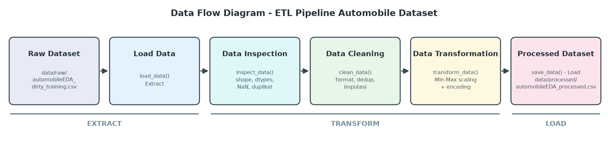

# Data Pipeline Assignment - Automobile Dataset

Individual Assignment *Data Engineering: Pipeline & Preparation* (AI Engineering Bootcamp, ReWork Academy).
Peserta: Adighani Ilham (CAI58).

Pipeline ETL berbasis Python + Pandas yang mengubah `automobileEDA_dirty_training.csv` (data mentah yang sengaja dikotori) menjadi `automobileEDA_processed.csv` yang siap dianalisis atau dimodelkan.

## Dataset
- **Deskripsi**: spesifikasi dan harga mobil (merek, body style, mesin, dimensi, konsumsi BBM, harga) ditambah kolom `transaction_date`.
- **Sumber**: `Dataset_Sesi_3.zip` dari materi Sesi 3 ReWork Academy (turunan dataset Automobile / IBM `automobileEDA`).
- **Input pipeline**: `data/raw/automobileEDA_dirty_training.csv` (tidak pernah diubah).

## Struktur Folder
```
data-pipeline-assignment/
├── data/
│   ├── raw/automobileEDA_dirty_training.csv
│   └── processed/automobileEDA_processed.csv
├── src/pipeline.py
├── documentation/
│   ├── data-flow-diagram.png
│   └── make_diagram.py          (skrip pembuat diagram)
├── README.md
└── requirements.txt
```

## Kondisi Awal Dataset
| Aspek | Temuan |
|---|---|
| Ukuran awal | **205 baris x 30 kolom** |
| Kolom dengan missing values | `transaction_date` (2), `make` (2), `num-of-doors` (2), `stroke` (4), `horsepower` (3), `price` (3), `horsepower-binned` (1) |
| Duplicate records | **4 baris** persis sama |
| Tipe data belum sesuai | `transaction_date` bertipe teks; `horsepower` dan `peak-rpm` bertipe float padahal bilangan bulat |
| Kategori tidak konsisten | `make` (`ALFA-ROMERO`, `Audi`, `dodge` dengan spasi di ujung), `body-style` (`SEDAN`, `Sedan`), `drive-wheels` (`AWD`, `RWD`), `fuel-system` (`MPFI`, `Mpfi`) |
| Masalah lain | `transaction_date` memakai 4 format campur (`2025-01-01`, `02/01/2025`, `01-03-2025`, `04-Jan-2025`); `horsepower-binned` kosong di sebagian baris; skala numerik sangat berbeda (harga puluhan ribu vs `height` puluhan) |

## Data Cleaning (di `clean_data()`) dan Alasannya
| Masalah | Penanganan | Alasan |
|---|---|---|
| Kategori tidak konsisten | `strip()` + `lower()` pada kolom teks kategorikal | `Sedan`, `SEDAN`, `sedan` adalah kategori yang sama; jika dibiarkan, encoding menghasilkan kolom ganda |
| 4 duplikat | `drop_duplicates()` setelah teks diseragamkan | Duplikat tersembunyi oleh perbedaan huruf ikut terdeteksi; baris ganda membiaskan statistik |
| Format tanggal campur | Parser multi-format ke `datetime`; 2 tanggal kosong diisi interpolasi linear | Data transaksi berurutan harian, jadi interpolasi menjaga urutan waktu |
| `make` kosong (2) | Diisi `unknown` | Merek tidak bisa ditebak dari kolom lain; baris tetap dipertahankan |
| `num-of-doors` kosong (2) | Modus per `body-style` | Jumlah pintu sangat ditentukan oleh body style |
| `stroke`, `horsepower`, `price` kosong | Median kolom | Median tahan outlier (harga dan horsepower berdistribusi miring) |
| `horsepower-binned` kosong/tidak sinkron | Dihitung ulang dari `horsepower` (3 bin sama lebar: Low/Medium/High) | Konsisten setelah imputasi |
| Tipe data | `horsepower`, `peak-rpm` jadi integer | Sesuai makna kolom |

## Transformasi (di `transform_data()`)
| Kolom | Metode | Alasan | Hasil |
|---|---|---|---|
| `length, width, height, curb-weight, engine-size, horsepower, city-mpg, highway-mpg, price` | **Min-Max Scaling** (0-1) | Skala berbeda jauh; model berbasis jarak/gradien sensitif terhadap skala | 9 kolom baru `*_scaled`, nilai asli tetap disimpan |
| `num-of-cylinders` | Ordinal mapping (`four` -> 4, dst.) | Urutan alami jumlah silinder | kolom baru `num-of-cylinders_num` |
| `make, aspiration, body-style, drive-wheels, engine-location, fuel-system` | **One-Hot Encoding** | Kategori nominal tanpa urutan | 44 kolom dummy (mis. `body-style_sedan`) |
| `horsepower-binned` | Label encoding (Low=0, Medium=1, High=2) | Kategori ordinal | kolom baru `horsepower-binned_code` |

### Contoh sebelum dan sesudah (5 baris pertama, hasil run asli)
| price | price_scaled | horsepower | horsepower_scaled | curb-weight | curb-weight_scaled | num-of-cylinders | num-of-cylinders_num | body-style | body-style_sedan |
|---|---|---|---|---|---|---|---|---|---|
| 13495.0 | 0.2080 | 111 | 0.2944 | 2548 | 0.4112 | four | 4 | convertible | 0 |
| 16500.0 | 0.2826 | 111 | 0.2944 | 2548 | 0.4112 | four | 4 | convertible | 0 |
| 16500.0 | 0.2826 | 154 | 0.4953 | 2823 | 0.5178 | six | 6 | hatchback | 0 |
| 13950.0 | 0.2193 | 102 | 0.2523 | 2337 | 0.3293 | four | 4 | sedan | 1 |
| 17450.0 | 0.3061 | 115 | 0.3131 | 2824 | 0.5182 | five | 5 | sedan | 1 |

## Jumlah Data Sebelum dan Sesudah
| | Baris | Kolom | Missing values |
|---|---|---|---|
| Raw | 205 | 30 | 17 sel kosong (7 kolom) |
| Processed | **201** | **85** | 0 |

## Alur ETL
- **Extract**: `load_data()` membaca CSV dari `data/raw/`.
- **Transform**: `inspect_data()` (pemeriksaan), `clean_data()` (pembersihan), `transform_data()` (scaling dan encoding).
- **Load**: `save_data()` menulis `data/processed/automobileEDA_processed.csv` sebagai file baru. `run_pipeline()` menggabungkan semuanya.



## Cara Menjalankan
```bash
pip install -r requirements.txt
python src/pipeline.py
```
Hasil inspeksi, log cleaning, dan contoh transformasi tampil di terminal. Processed dataset dihasilkan otomatis oleh pipeline (bukan disalin dari clean dataset mentor) di **`data/processed/automobileEDA_processed.csv`**.

> Catatan: berkas `data/raw`, `data/processed`, dan diagram di repo ini dibuat oleh workflow `.github/workflows/build-artifacts.yml`, yang menyalin dataset resmi Sesi 3 lalu menjalankan `src/pipeline.py` dan `documentation/make_diagram.py`, sehingga hasilnya dapat direproduksi.
